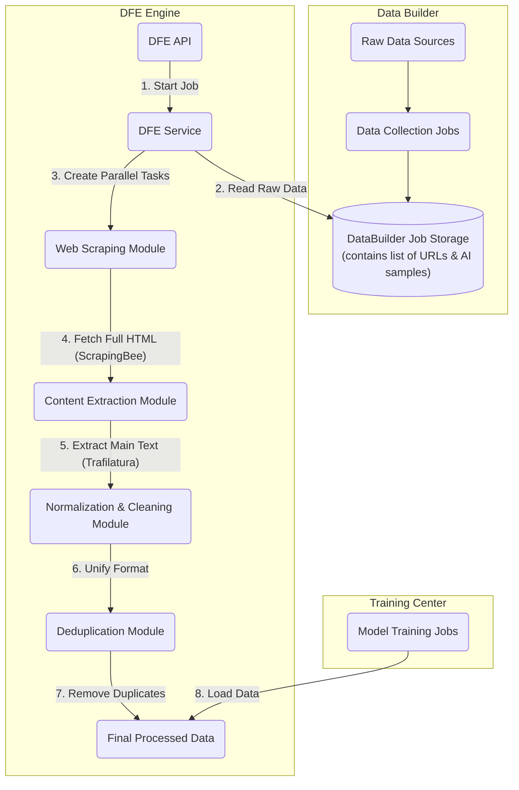

# DFE (Data Fusion Engine): Engineering Guide & Technical Specification

## 1. Overview & Mission

### 1.1. Mission Statement
The Data Fusion Engine (DFE) is the core data processing pipeline of the Metra platform. Its mission is to transform raw, noisy, and unstructured data collected by the **Data Builder** into high-quality, clean, and standardized datasets ready for model training.

### 1.2. The Refinery Analogy
- **Data Builder** is the **"Miner"**: It rapidly discovers and collects raw ore (URLs, snippets, AI-generated samples) from various sources.
- **DFE Engine** is the **"Refinery"**: It takes this raw ore and subjects it to a rigorous refinement process (fetching, cleaning, normalization, deduplication) to produce standardized, high-purity "gold bars" (training-ready `.jsonl` files).

---

## 2. Core Architectural Principles

- **Separation of Concerns**: DFE's responsibilities begin where the Data Builder's end. The Data Builder is responsible for **discovery** (finding URLs), while the DFE is responsible for **extraction and processing** (visiting URLs and refining content). This separation ensures speed in the discovery phase and robustness in the processing phase.
- **Asynchronous & Parallel Processing**: To handle potentially thousands of URLs, all I/O-bound tasks (especially web scraping) MUST be performed asynchronously and in parallel to maximize throughput.
- **Idempotency**: A DFE job, when run on the same input, should always produce the identical output. This is crucial for reproducibility.
- **Configurability**: While the core pipeline is automated, it should be designed to allow for future configuration (e.g., custom cleaning rules, quality thresholds).

---

## 3. System Architecture & Data Flow



### Data Flow Steps:
1.  A user initiates a DFE job via the **DFE API**, providing a `data_builder_job_id`.
2.  The **DFE Service** retrieves the corresponding raw data list (containing URLs and AI-generated samples) from the Data Builder's storage.
3.  The service separates the data: AI-generated samples are set aside, while web-sourced URLs are passed to the **Web Scraping Module**.
4.  The Web Scraping Module uses `aiohttp` to make parallel requests to the **ScrapingBee API** for each URL, fetching the full HTML content.
5.  Each returned HTML page is passed to the **Content Extraction Module**, which uses the `trafilatura` library to extract only the main article text, discarding ads, navigation, and other boilerplate.
6.  The clean text is passed to the **Normalization Module**, where it is transformed into the standard project-wide JSON format (e.g., `{"text": "...", "label": "..."}`).
7.  All normalized web data is merged with the initial AI-generated data. This combined dataset is then processed by the **Deduplication Module** to remove exact duplicates.
8.  The final, clean, and unique dataset is stored and marked as "complete", ready to be consumed by the **Training Center**.

---

## 4. Concrete Example: Training a "TCM AI"

This example illustrates the transformation from raw data to a training-ready dataset.

### 4.1. Input: Raw Data from Data Builder

The DFE service receives this list, where the goal is to create `TCM_QA` (Traditional Chinese Medicine Question-Answer) pairs.

```json
[
  // Web-sourced data (needs processing)
  {
    "title": "枸杞 - 维基百科",
    "snippet": "中医认为枸杞子性平，味甘，具有滋补肝肾...",
    "url": "https://zh.wikipedia.org/wiki/枸杞",
    "source": "google_search"
  },
  {
    "title": "求助！最近总是失眠多梦，怎么办？- 养生论坛",
    "snippet": "楼主：我最近压力大，晚上睡不着...",
    "url": "https://example-tcm-forum.com/thread-12345",
    "source": "google_search"
  },

  // AI-generated data (already in a good format)
  {
    "content": "{\"prompt\": \"我有点上火，该吃什么？\", \"response\": \"建议您食用一些性凉的食物，如绿豆汤、冬瓜等。\"}",
    "label": "TCM_QA",
    "source": "ai_generated"
  }
]
```

### 4.2. Output: Refined Data from DFE Engine (The Final Product)

After the DFE pipeline runs, the final output will be a clean `.jsonl` file, ready for training. Notice how the unstructured web data has been transformed into the target format.

```json
// File: dfe_job_xyz.jsonl
{"text": "{\"prompt\": \"枸杞有什么用？\", \"response\": \"中医理论认为，枸杞子性平，味甘，归肝、肾经。具有滋补肝肾、益精明目的功效。常用于治疗肝肾阴虚、腰膝酸软、头晕目眩、视力减退等症。\"}", "label": "TCM_QA"}
{"text": "{\"prompt\": \"我最近压力大，晚上睡不着，就算睡着了也一直做梦，怎么办？\", \"response\": \"可以试试酸枣仁汤，它有很好的安神效果。\"}", "label": "TCM_QA"}
{"text": "{\"prompt\": \"我有点上火，该吃什么？\", \"response\": \"建议您食用一些性凉的食物，如绿豆汤、冬瓜等。\"}", "label": "TCM_QA"}
```

**Key Transformations Demonstrated in the Example:**
- The Wikipedia article on "枸杞" (Goji Berry) was transformed from a block of text into a structured Q&A pair.
- The forum post about insomnia was intelligently parsed, extracting the user's core problem and a relevant answer, discarding noise like "楼主" or irrelevant replies.
- The final dataset has a **single, unified format**, making it trivial for the training script to consume.

---

## 5. API & Service Specification

### 5.1. API Endpoints (`/api/v1/dfe`)

-   **`POST /start`**:
    -   **Request Body**: `{ "data_builder_job_id": "string" }`
    -   **Response Body**: `{ "dfe_job_id": "string", "status": "started" }`
    -   **Action**: Initiates a new background DFE processing job.
-   **`GET /status/{dfe_job_id}`**:
    -   **Response Body**: `{ "status": "string", "progress": "number", "stats": { ... } }`
    -   **Action**: Returns the real-time status and statistics of a running job.
-   **`GET /results/{dfe_job_id}`**:
    -   **Response Body**: `{ "data": [ ... ], "summary": { ... } }`
    -   **Action**: Returns the final, processed data and a summary report once the job is complete.

### 5.2. Core Service (`DFEService`)

The engineer will need to implement the logic within the `process_job` method in `backend/app/services/dfe_service.py`.

**Key Implementation Tasks:**
1.  Filter the raw data list to create a list of URLs to be scraped.
2.  Implement a parallel `fetch_and_extract` function that:
    - Takes a URL as input.
    - Calls `ScrapingBee` API to get the HTML.
    - Uses `trafilatura.extract()` on the returned HTML to get the main text.
    - Returns the clean text.
3.  Use `asyncio.gather` to run `fetch_and_extract` on all URLs concurrently.
4.  Implement a `normalize_data` function that takes the extracted text and formats it into the standard JSON structure.
5.  Merge the newly processed web data with the original AI-generated data.
6.  Implement a `deduplicate` function based on the `text` field of the JSON objects.
7.  Update the job status and save the final results.

This guide provides a comprehensive blueprint for the construction of the DFE module. 