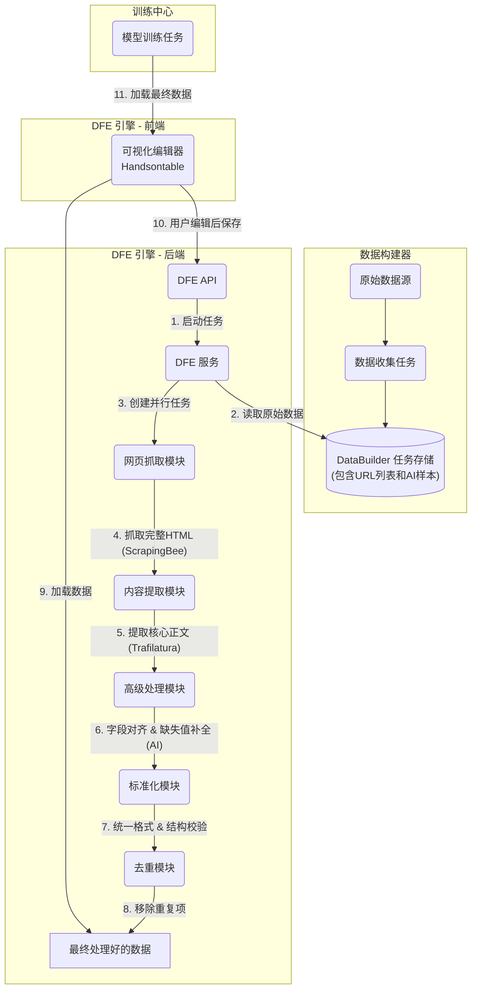

# DFE (数据融合引擎): 工程指南与技术规范 (V2.0)

## 1. 概述与使命

### 1.1. 使命宣言
数据融合引擎 (DFE) 是 Metra 平台的核心数据处理管道。其核心使命是将由 **Data Builder (数据构建器)** 所收集的、充满噪音的原始非结构化数据，转化为可直接用于模型训练的、高质量、干净且标准化的数据集。

### 1.2. “精炼厂”类比
- **Data Builder** 如同“**矿工**”：它负责从各种来源（网页、AI）快速发现并收集原始矿石（URL、文本摘要、AI 生成样本）。
- **DFE Engine** 如同“**精炼厂**”：它接收这些原始矿石，并通过一套严谨的精炼流程（抓取、清洗、**智能补全**、标准化、去重），最终产出标准化的、高纯度的“金条”（即刻可用的 `.jsonl` 训练文件）。

---

## 2. 核心架构原则

- **关注点分离 (Separation of Concerns)**：DFE 的职责始于 Data Builder 的职责终点。Data Builder 负责**发现**，而 DFE 负责**提取与处理**。
- **异步与并行处理 (Asynchronous & Parallel Processing)**：所有 I/O 密集型任务（尤其是网页抓取）**必须**异步并行执行，以最大化吞吐量。
- **智能化处理 (AI-Powered Processing)**：在关键步骤（如字段对齐、缺失值补全、数据结构化）引入小型 AI 模型，将重复性体力劳动自动化，提升数据处理的准确性和效率。
- **用户在环 (Human-in-the-Loop)**：最终产出的数据需要提供给用户进行**可视化预览和编辑**。用户的反馈和修正可以被用于未来流程的优化。
- **幂等性 (Idempotency)**：一个 DFE 任务，在接收相同输入时，应总是产生完全相同的输出。

---

## 3. 系统架构与数据流 (V2.0)



### 数据流步骤详解 (V2.0):
1.  用户通过 DFE API 发起任务。
2.  DFE 服务读取原始数据。
3.  **网页抓取**：并行抓取所有 URL 的完整 HTML。
4.  **内容提取**：使用 `trafilatura` 提取核心正文。
5.  **智能处理 (新增)**：
    -   **字段对齐**：使用 AI 模型或同义词库，将 `review`, `comment` 等字段名自动映射为标准的 `text` 字段。
    -   **缺失值补全**：如果一条数据缺少 `label`，调用 AI 模型根据其内容预测并补全一个最可能的标签。
6.  **标准化与校验**：
    -   将所有数据转换为统一的 JSON 结构。
    -   进行严格的结构校验，确保数据类型正确。
7.  **去重**：合并所有数据，并移除内容完全一样的重复条目。
8.  **可视化与编辑**：
    -   处理完成的数据加载到前端的 **Handsontable** 编辑器中。
    -   用户可以像使用 Excel 一样，对数据进行最后的浏览、筛选和手动修正。
9.  **最终输出**：用户确认后，系统生成最终的 `.jsonl` 文件，准备好被**训练中心**调用。

---

## 4. 具体实例：训练一个“中医 AI” (V2.0 视角)

这个例子清晰地展示了数据从原始形态到可训练形态的转变过程。

### 4.1. 输入：来自 Data Builder 的原始数据

DFE 服务接收到以下列表，其目标是创建 `TCM_QA` (中医问答) 数据对。

```json
[
  // 需要处理的网页源数据
  {
    "title": "枸杞 - 维基百科",
    "snippet": "中医认为枸杞子性平，味甘，具有滋补肝肾...",
    "url": "https://zh.wikipedia.org/wiki/枸杞",
    "source": "google_search"
  },
  {
    "title": "求助！最近总是失眠多梦，怎么办？- 养生论坛",
    "snippet": "楼主：我最近压力大，晚上睡不着...",
    "url": "https://example-tcm-forum.com/thread-12345",
    "source": "google_search"
  },

  // 格式已经很好的 AI 源数据
  {
    "content": "{\"prompt\": \"我有点上火，该吃什么？\", \"response\": \"建议您食用一些性凉的食物，如绿豆汤、冬瓜等。\"}",
    "label": "TCM_QA",
    "source": "ai_generated"
  }
]
```

### 4.2. 输出：来自 DFE 引擎的精炼数据（最终成品）

DFE 管道运行完毕后，最终的输出将是一个干净的 `.jsonl` 文件，可以直接用于训练。请注意非结构化的网页数据是如何被转化为目标格式的。

```json
// 文件: dfe_job_xyz.jsonl
{"text": "{\"prompt\": \"枸杞有什么用？\", \"response\": \"中医理论认为，枸杞子性平，味甘，归肝、肾经。具有滋补肝肾、益精明目的功效。常用于治疗肝肾阴虚、腰膝酸软、头晕目眩、视力减退等症。\"}", "label": "TCM_QA"}
{"text": "{\"prompt\": \"我最近压力大，晚上睡不着，就算睡着了也一直做梦，怎么办？\", \"response\": \"可以试试酸枣仁汤，它有很好的安神效果。\"}", "label": "TCM_QA"}
{"text": "{\"prompt\": \"我有点上火，该吃什么？\", \"response\": \"建议您食用一些性凉的食物，如绿豆汤、冬瓜等。\"}", "label": "TCM_QA"}
```

**实例中展示的关键转换：**
- 关于“枸杞”的维基百科文章，从一段陈述性文本被转换成了一个结构化的问答对。
- 关于失眠的论坛帖子被智能地解析，提取了用户的核心问题和一个相关的答案，并丢弃了像“楼主”或无关回复之类的噪音。
- 最终的数据集拥有**单一、统一的格式**，这使得训练脚本可以极其简单地消费这些数据。

---

## 5. API 与服务规范 (V2.0)

### 5.1. API 端点 (`/api/v1/dfe`)

-   **`POST /start`**: (不变)
-   **`GET /status/{dfe_job_id}`**: (不变)
-   **`GET /results/{dfe_job_id}`**: (不变)
-   **`POST /results/{dfe_job_id}` (新增)**:
    -   **请求体**: `{ "updated_data": [...] }`
    -   **功能**: 接收由前端 Handsontable 编辑器传回的用户修正过的数据，并覆盖保存。

### 5.2. 核心服务 (`DFEService`)

#### V1 实现范围 (基础版 - 首要目标)
1.  **并行抓取与提取**：实现 `fetch_and_extract` 函数，使用 `ScrapingBee` 和 `trafilatura`。
2.  **基础标准化**：实现 `normalize_data`，将数据转换为 `{ "text": "...", "label": "..." }` 格式。
3.  **精确去重**：实现 `deduplicate` 函数。
4.  **生成结果**：将最终数据保存，并可通过 API 访问。

#### V2 实现范围 (高级版 - 后续迭代)
1.  **AI 字段对齐**：在 `normalize_data` 之前，集成一个小型 AI 模型或配置，用于识别和统一字段名。
2.  **AI 缺失值补全**：为 `label` 等关键字段的缺失情况，实现 AI 补全逻辑。
3.  **前端集成 Handsontable**：
    -   在 DFE 结果页面，使用 `Handsontable` React 组件来展示数据。
    -   实现数据的加载、编辑、排序和筛选功能。
    -   实现“保存修改”按钮，该按钮会调用新增的 `POST /results/{dfe_job_id}` 接口。

本指南为 DFE 模块的构建提供了一个从 V1 到 V2 的、清晰的、可分阶段实施的演进蓝图。 